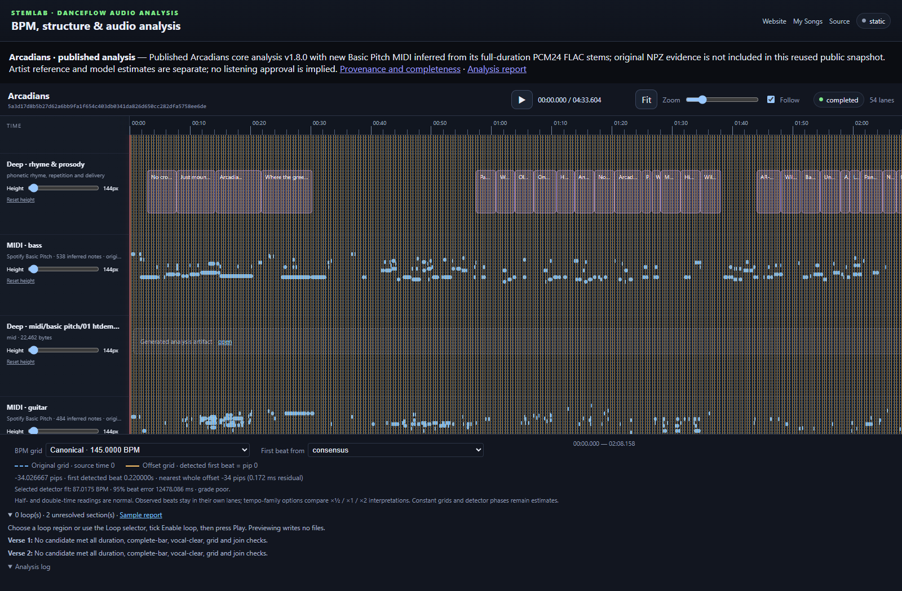
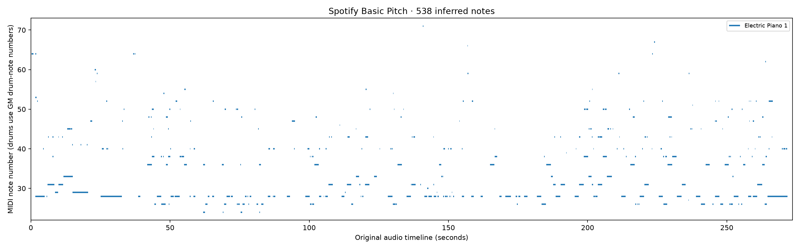

# Arcadians complete core analysis and MIDI

The `arcadians-core-v3` recipe is part of StemLab's **Arcadians complete analysis
timeline** workflow. The combined **Arcadians release demo** workflow calls it,
checks all viewers, and supplies the artifact consumed by the existing Pages
deployment. The original MP3 is mounted read-only; every run uses new directories.

Actual implementation capture, 21 October 2026: the published v1.8.0 analysis
was reused locally and Basic Pitch inferred new notes from its full-duration
PCM24 FLAC stem derivatives. This capture is not evidence of a fresh complete
CI analysis or a deployed v3 page. Full-resolution NPZ evidence is absent from
that reused public snapshot; the fresh CI recipe produces it from the master.

[Play the silent local interface demonstration](screenshots/arcadians-midi-real-local.webm).
Transcript: the timeline scrolls to the bass MIDI note lane, the user presses
Play, the shared audio clock advances, and Pause stops playback. Native MIDI
downloads sit beside each inferred note lane. Playback is user controlled.

This plot is generated from the local model's actual bass MIDI output. It shows
estimated notes on the original audio clock, rather than artist-approved scoring.
It is a data plot, not an illustrative reconstruction of an unseen performance.

## Coverage and validation

The fresh CI run covers the full checksum-locked recording with six HTDemucs
stems; master/stem NPZ spectrograms; repetition-safe Whisper; master/percussion
BeatNet and BeatThis; demixed Beat Transformer; All-In-One; balanced consensus;
13 Vamp transforms; sonic, rhythm, harmony, structure, lyric and text-semantic
analysis; song-map fusion; and loop discovery. A legitimate zero-loop result is
retained with its unresolved sections.

Basic Pitch runs on bass, guitar, piano, vocals and other. Each result must
complete, identify its exact stem hash/sample rate/frame count, parse as native
MIDI and agree with its JSON note table. Empty individual transcriptions remain
explicit; the whole demo must contain genuine note data. Drum audio is available,
but this model does not supply a drum-class transcription. Other optional MIDI,
specialist, separator-comparison and non-commercial audio-semantic models are
outside this declared core recipe.

The renderer is the released React Timeline Sequence component. HTTP browser QA
requires painted note lanes, five working MIDI downloads, audio play/pause/seek,
source-clock agreement and retained display controls. Static Pages does not
start Python, load plugins, run models or offer server-backed timing editors.
Use local StemLab/StemMoves services for persistent editing and offline effects.

## Published and retained files

Pages includes bounded, sanitized MIDI reports and note JSON, unchanged native
MIDI, the exact public MP3, and disclosed full-duration PCM24 FLAC listening
derivatives. The analysis Actions artifact separately retains original float
stems, raw evidence and native MIDI. Requests, private paths, worker logs and
models stay outside the public site. The five existing Arcadians viewers and
the independent The Truth is a Virus beat reference are published together.

Confirmed 145 BPM, canonical words/timings and artist section labels remain
separate from estimates. MIDI tempo is an export clock, not a BPM measurement.
The checks establish files, provenance and UI behavior; they do not establish
attended listening quality or acoustic transcription accuracy.
