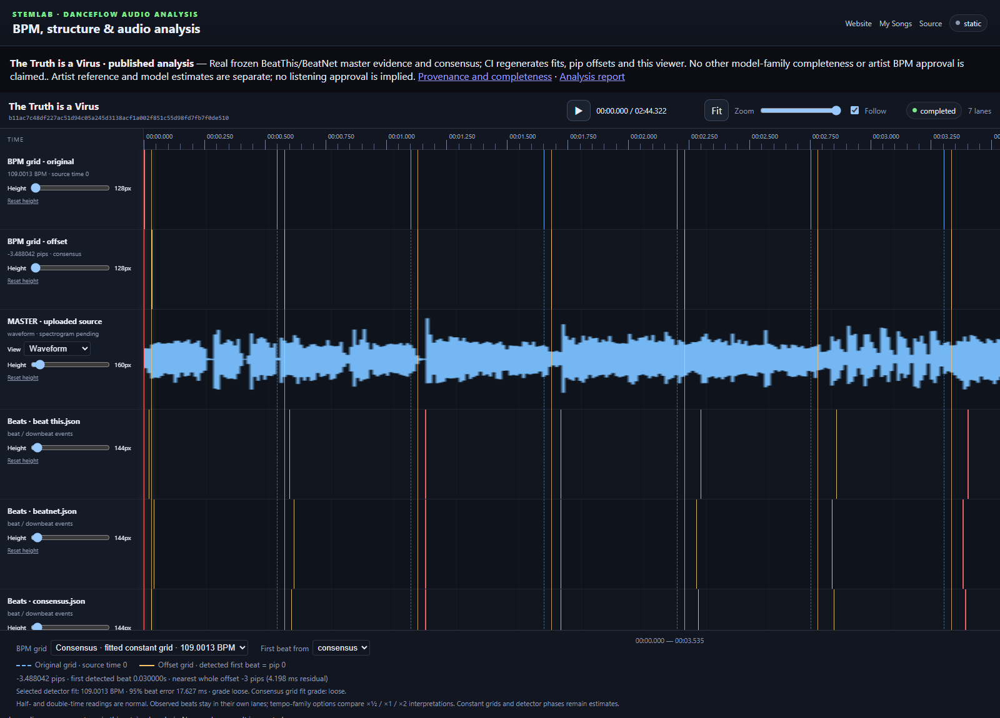

# First-beat pip offsets and tempo interpretations

`stemlab beat-offset RESULTS --output NEW_REPORT_DIRECTORY` compares the actual
first timestamp of the saved consensus and every individual detector/source run.
It writes `beat-offsets.json` and `beat-offsets.csv`, without inference or changing
audio, canonical metadata, timestamps or previous reports. Use `--audio FILE`
to verify the original audio hash and frame metadata, and `--canonical-bpm BPM`
only for an independently established reference; otherwise `canonical.json` is used.

One native DanceRudiments beat contains **64 pips**. The signed additive mapping is:

```text
aligned_pip = source_seconds × BPM / 60 × 64 + offset_pips
offset_pips = −first_detected_beat_seconds × BPM / 60 × 64
```

Thus a first beat at 0.125 seconds at 120 BPM requires **−16 pips**, mapping it
to pip 0. Exact rational offsets are retained alongside fractional numeric pips,
nearest integer pips and their signed rounding error in pips and seconds. Exact
half-pip ties round away from zero. A fractional offset must not be silently
replaced by its integer approximation. DanceMoves uses 16 ticks per beat, so a
pip offset corresponds to one quarter as many ticks, without premature rounding.

Every usable detector is compared against these distinct tempo bases:

- Canonical BPM, when supplied. No detector result becomes canonical automatically.
- The saved combined consensus BPM; when absent, the existing median-interval
  estimator is applied to the saved consensus timestamps, without re-voting.
- Its closest ×½ / ×1 / ×2 interpretation relative to the canonical BPM.
- A constant-grid fit of the unchanged consensus timestamps, with StemLab's
  existing fit error, end-drift guard and precision grade.

Half- and double-time detections are normal metrical interpretations. Keep the
observed beats and BPMs, show all three tempo-family candidates, and distinguish
generated grid subdivisions from detected events. Source/percussion runs of the
same detector are not independent votes. An unavailable or failed detector stays
unavailable; a summary beat count is not timestamp evidence.

In the real React timeline, **BPM grid** selects the tempo basis and **First beat
from** selects consensus or an individual detector. The **blue dashed original
grid** starts at source time 0; the **amber solid offset grid** starts at the
selected first detected beat. Both have their own marker lane and overlay.
Selections preserve transport state and observed-event lanes. When canonical BPM
is unavailable, the viewer initially offers the fitted consensus grid, explicitly
labelled as an estimate. No aligned grid is fabricated without usable evidence.



## Two complementary real-song examples

Arcadians retains its artist-confirmed **145 BPM** reference. Its published
consensus reading near **72.73 BPM** is a normal half-time interpretation; its
double-time family candidate is approximately **145.45 BPM**. These do not change
the canonical reference, and a first beat remains an estimated phase.

[The Truth is a Virus](https://kieransimkin.github.io/stemlab/timeline/the-truth-is-a-virus/)
is the released, artist-selected contrasting reference. Fresh bounded master
analysis on 16 October 2026 produced real BeatThis and BeatNet results plus their
strict majority-vote consensus. Their fitted tempos are approximately 109 BPM.
For the consensus, 95% of timestamps lie within **17.627 ms of its fitted constant
grid** (109.0013 BPM). This measures grid consistency, not perceptual ground truth.
The first-anchored end drift is **67.114 ms**, and the existing guarded precision
grade remains **loose**. Its raw consensus median-interval tempo, **109.090909 BPM**,
is also shown, alongside individual detector median estimates of **107.142857 BPM**;
none is overwritten with the fit. Canonical BPM is explicitly unavailable.

CI regenerates the report and actual viewer from these checksum-pinned frozen
detections and the exact already-public MP3. It verifies original audio identity,
all six usable detector/tempo comparisons, real HTTP playback, selectors and
distinct painted grid colours/styles. CI does not rerun these learned models or
claim every analysis family ran. Local All-In-One attempts lacked the cached
checkpoint and are not substituted with synthetic or copied detections.

## Keep the two clocks separate

Beat phase shifts rhythmic movement, not the source programme. Audio, lyrics,
cue timestamps, sample/frame bounds and audio-derived frequency recordings keep
their original source time. For an excerpt, map player/output time back to source
song time first, then apply the beat alignment exactly once. A fixed-tempo grid
and first detected event do not prove whole-song alignment, downbeat identity or
musical approval. Preserve tempo changes, uncertainty and independent listening.

Export an explicit renderer/playback handoff alongside the comparison:

```sh
stemlab beat-offset RESULTS --audio MASTER --output NEW_REPORT_DIRECTORY --alignment-analysis consensus --alignment-bpm-basis canonical
```

`beat-alignment.json` (`stemlab.beat-alignment.v1`) binds the selected row to the
master hash, original frame metadata, detector evidence hash and comparison-file
hash. It carries exact BPM/first-beat/offset rationals, 64-pip units and separate
BPM/phase statuses. Use `combined_fit` explicitly when canonical BPM is unavailable;
that keeps BPM estimated. A canonical BPM does not make detector phase confirmed.
Consumers must verify their exact source and apply the rhythmic offset once,
after mapping excerpts/repeats/preroll into original song time. A missing or
unavailable selection fails without inventing an offset.
