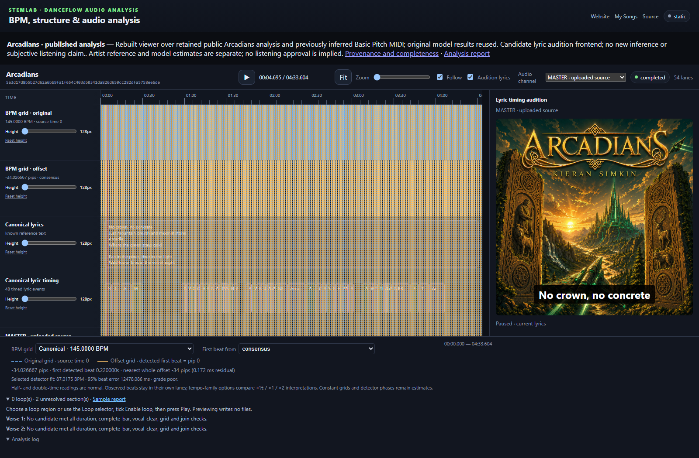
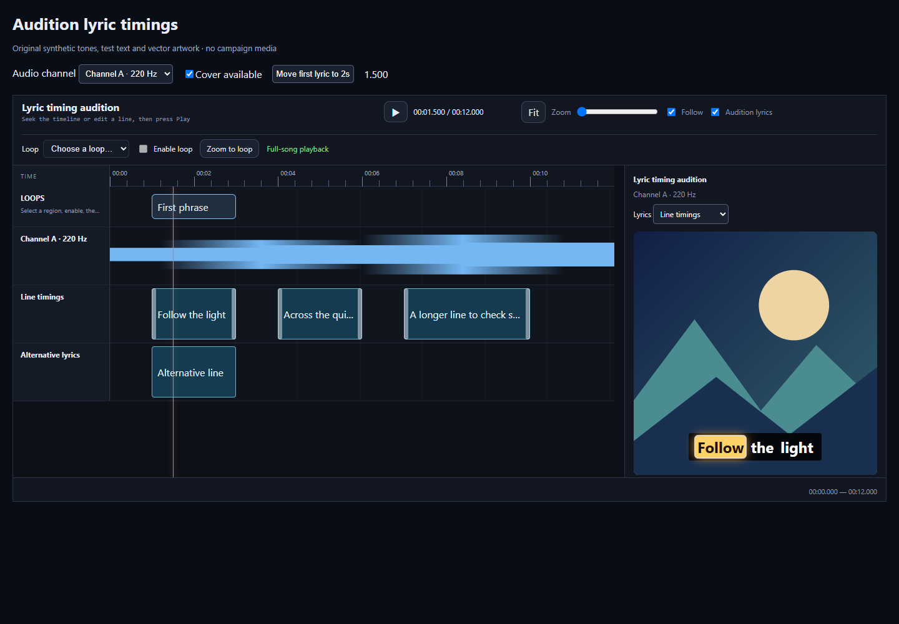
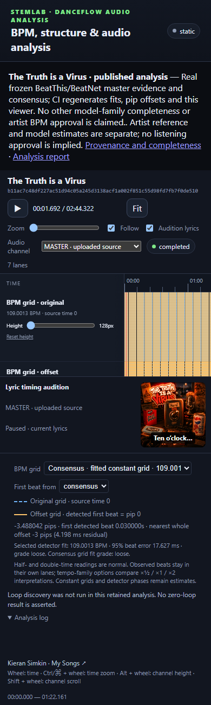
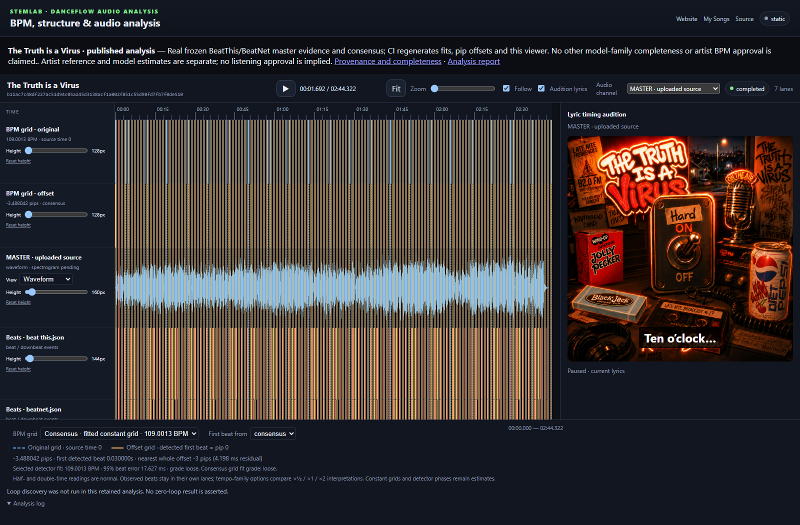

# Audition lyric timings in StemLab

The live and exported viewers use released React Timeline Sequence 0.7.0's
`lyricAudition` API. Enable **Audition lyrics** in the transport to see the active
line as a subtitle over the cover and the current timed word highlighted. Playback, paused seeks, buffered loops and
lyric edits use the same source clock as the timeline playhead.



Actual rebuilt viewer over retained public Arcadians analysis and previously
inferred MIDI. This screenshot establishes UI behaviour, not new inference,
subjective listening approval or an artist's confirmation of inferred notes.

Choose **Audio channel** to listen to the original master or a full-duration stem
from the same analysis. Changing channels pauses the old source and resets its
position; press Play again. Short clips and unavailable waveforms are excluded.
Stem loop playback decodes the selected stem and preserves the original region
seconds; it cannot reuse a master-only loop excerpt or download label.

Live edits consume the complete line track, including unsaved changes, regardless
of editor visibility or timeline scrolling. Empty edited tracks stay empty.
The complete word track is supplied separately, so selecting one line in the
editor does not hide other words from audition. Exact `line_id` associations
keep simultaneous lead and backing-vocal words separate. Missing word evidence
falls back to whole-line display rather than fabricated equal-width timing.



Actual React Timeline Sequence 0.7.0 browser capture using its original synthetic
tone, text and vector-art fixture. It demonstrates the integrated active-word
state; it is not song-timing or attended-listening evidence.
Before an editable document exists, saved canonical lyric timings are used.
Static exports use their saved timing source and remain read-only.



Responsive layout evidence at 390 CSS pixels; this is browser emulation, not a
physical-phone playback or performance measurement.



This contrasting reference uses 57 artist-confirmed canonical line intervals,
with explicit ends from the adopted LRC. Its additional `lyric-audition.json`
identifies the exact public source and artwork hashes. Original detector files,
frozen `canonical.json`, beat fits and unconfirmed BPM state remain unchanged.
Music, artwork and lyric rights remain with their owners, independently of the
software's MIT licence.

## Try rebuilt local examples

Serve only a prepared export tree, containing its own index, audio and snapshots:

```sh
python scripts/serve_timeline_examples.py path/to/generated-examples --port 8768
```

Open the printed loopback URL and select a song. Stop the server with Ctrl+C.
The server uses the maintained byte-range handler so seeking works, and binds
only to loopback. It does not expose or list private analysis directories.

For any other authorized saved analysis, include its cover explicitly:

```sh
stemlab export-timeline path/to/analysis --include-audio --artwork path/to/cover.jpg --output path/to/new-site
```

The exported cover is a local PNG/JPEG/WebP asset, inventoried and hashed with the
snapshot. The bundled Arcadians cover is selected automatically only for its
checksum-locked master. Other exports without a local cover show an accurate
unavailable state. The exporter does not fetch remote cover URLs.

## Verification and recording

[Play the silent viewer demonstration](screenshots/lyric-audition-demo.webm).
User-controlled recording; no audio track. Transcript: seek into a lyric line,
play and pause the original master, choose a full-duration stem, seek and play
that stem with synchronized subtitles, then inspect the second song and phone
layout. Technical playback checks are separate from attended listening.

The maintained `check_arcadians_timeline.py` HTTP check also verifies the subtitle
text, local artwork loading, preview toggle and selected stem playback. It retains
the existing range, waveform/spectrum, grid, MIDI, seek, loop and cleanup checks.
The adapter tests cover complete edit precedence, original seconds, full-duration
channel selection and master-versus-stem loop provenance. Rebuild and hash the
actual frontend through `configure_viewer_build.py`; never patch compiled marker
strings to simulate integration.
