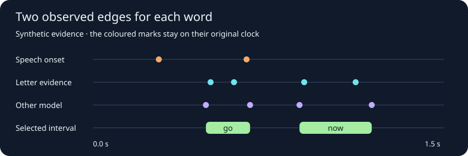

# Compare lyric onsets and releases

Whisper word times can stretch a first word across a rest, or give two written
words one observed timestamp. StemLab can now inspect a second acoustic signal:
a letter-level CTC path inside a window for each **occurrence** of a lyric line.
The window prevents one copy of a refrain from matching a distant repeat. It
does not establish that the supplied words were sung.



This figure comes from the same selector used for draft evidence. The dots are
original candidate times; the selected bars use actual observed endpoints. The
fixture is synthetic. It has no audio performance or new UI to record. The
[existing lyric audition demo](lyric-audition.md) shows the shared viewer.

## Get local letter evidence

Use the English [TorchAudio WAV2VEC2_ASR_BASE_960H checkpoint](https://docs.pytorch.org/audio/stable/generated/torchaudio.pipelines.WAV2VEC2_ASR_BASE_960H.html).
Provision it under the owning project's ignored `models/` directory. StemLab
checks the filename and SHA-256 before loading it. This command never downloads
weights. An English speech model can miss letters in held notes, quiet pickups,
blends or a sung pronunciation. Its 20 ms frame spacing is not measured timing
accuracy.

```powershell
python -m stemlab.lyric_ctc --audio vocals.wav --lyrics canonical.txt `
  --windows windows.json --checkpoint models/wav2vec2_fairseq_base_ls960_asr_ls960.pth `
  --output ctc-vocals.json
```

The windows file is a list of `[start_seconds, end_seconds]` pairs in canonical
nonblank line order. Build windows from existing occurrence anchors, or mark them
by listening; keep the search bounded even when supplying extra model context.
Use a full-length vocal stem only when its clock is verified against the master.
The report retains the input hash, model, original input frame bounds, each
canonical token, letter peaks, a free-decoded letter trace, and weak or clipped
edges. An unresolved window has no timed words.

## Compare observations without averaging

`stemlab.lyric_boundaries.select_boundaries` takes proposed onset/release edges
already verified to refer to the same source clock, canonical occurrence and
vocal part. It selects ordered positive intervals from those exact frames, with
separate provenance for the two edges. Keep multiple separator or Whisper
passes from the same model family together. One family can contribute at most
one corroborating vote per edge. Original alternatives, competing families and
missing timings stay visible. Model weights and agreement scores are review
evidence, not calibrated confidence. This API does not establish source
mapping, infer part identity or overwrite artist edits.

For an audition you can optionally require a minimum word span. This prevents
a late consonant observation and early release from forming an implausibly
short highlight. It drops the pair without moving either endpoint.

Weak observations stay visible but do not count as corroboration. An onset
and release that agree separately can still make a word too short. The
selector now also checks whether a single original interval supports both
edges and the resulting duration, and reports when there is no such interval.

Where you have reliable occurrence windows, pass them to
`stemlab.word_alignment.reconcile(..., line_windows={1: (12.4, 16.0)})`.
Keys are physical lyric file line numbers, including blank lines in numbering.
The entire observed word must fit the chosen window. An observation from a
later chorus cannot fill a missing word in the earlier one.

When preparing the inputs, compare consonant evidence, free recognition and
held-vowel releases separately. A grapheme edge need not match the audible
onset of a sustained sung syllable. Flag unsupported words and review early or
late pickups in context before delivering an artist-approved timing file.
Follow [line-level export checks](lyric-line-gates.md) and use
[StemEdit](lyric-audition.md) for listening and any corrections.

## Draft and score line display timing

Run `stemlab lyric-display` on the `word-timings.json` produced by
`scripts/reconcile_canonical_words.py`. The command writes a new JSON review
file with `display_start`, `display_clear` and the observed first/last word
edges. It uses exact canonical word matches and leaves missing edges unknown.

```text
stemlab lyric-display word-timings.json --output display-review.json
stemlab lyric-display word-timings.json --output display-comparison.json --reference-lrc artist.lrc --hold-until-next-within 1.5
```

In the synthetic example below, the long first-word observation runs from
1.00 to 2.70 s. The display heuristic proposes 1.765 s as the line start. A
1.5 s hold can keep the line visible from the last word's 2.70 s end through
the next line at 4.00 s. The default leaves the gap unheld. Use
`--no-pickup-adjustment` to compare with the first-word onset directly.

| Event | Acoustic observation | Default display | Optional hold |
| --- | ---: | ---: | ---: |
| First start | 1.00 s | 1.765 s | 1.765 s |
| First end | 2.70 s | 2.70 s | 4.00 s |
| Next start | 4.00 s | 4.00 s | 4.00 s |

For `--reference-lrc`, establish that the file refers to the same recording and
written occurrences. The command checks word order, source duration and LRC
offsets and records a digest of the reference. It scores display starts and
explicit blank-tag clears, flags ambiguous clears and counts missing estimates
in coverage. A manually held line supplies an editorial clear. Measure word
accuracy against separate listening annotations. The two input files stay
read-only. Review the JSON before applying any suggestions in your editor.

When evaluating a new policy, keep whole songs out of fitting, report coverage
and median/tail error, and retain the unshifted baseline. A rule that helps the
largest misses can move an already well-timed line. Use the existing audition
guide for the playback interface. [Actual StemEdit demo](lyric-audition.md)

## Reproduce the figure

```text
python examples/lyric-boundaries/build_example.py new-boundary-example.svg
pytest tests/test_lyric_ctc.py tests/test_lyric_boundaries.py tests/test_lyric_quality.py
```
