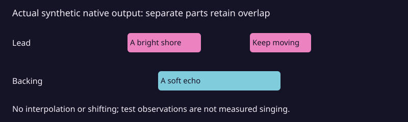

# Recover lyric timing without manufacturing missing cues

ASR recognition, canonical text reconciliation and acoustic known-text alignment
are different operations. A high whole-song recognition score cannot validate a
missing verse or a repeated phrase matched across a long instrumental gap.

`lyric_lrc.build_lrc` now checks per-line spans, compressed clusters and rounded
onset collisions before returning a complete LRC. Missing lines are never
interpolated. Existing late observed anchors remain explicitly flagged and need
listening review. No API in this workflow promotes an estimate automatically.



*Generated from the native `assemble_lines` result in the reproducible synthetic
example below. These are test observations, not measured singing or voice
separation evidence. A video or generated pictorial artwork would add no timing
evidence to this static comparison.*

## Repetition-safe recognition and complete export

```powershell
python -m stemlab.lyric_batch --lyrics canonical.txt --audio vocal-a.wav `
  --audio vocal-b.wav --model models/whisper-local --output-dir new-review
```

This uses full audio and disables previous-window conditioning by default. An
existing local model is required. Actual audio headers supply duration. Every
candidate retains native speech, word reconciliation and line-quality evidence.
Only complete line-valid candidates are ranked. Exit 2 means evidence was saved
but complete LRC export was held; do not restore an old interpolating exporter.
Existing output directories and artist edits cannot be overwritten.

## Optional acoustic alignment with existing faster-whisper weights

```powershell
pip install 'danceflow-stemlab[lyric-alignment]'
python -m stemlab.lyric_acoustic --audio vocals.wav --lyrics canonical.txt `
  --model models/whisper-local --output new-acoustic-review `
  --title 'Synthetic song' --artist 'Test artist'
```

The optional adapter pins `stable-ts-whisperless` 2.19.1 and reuses local
faster-whisper weights. The upstream stable-ts project is paused; this explicit
optional dependency is separate from normal StemLab speech inference and the
existing Qwen forced-aligner route. No model downloads occur here. Runtime and
model provisioning remain the caller's explicit choice.

Known-text alignment preserves canonical line groups, retains raw word failures
and applies crop offsets once. It disables non-speech skipping and silence-based
timestamp adjustment. Missing/instant words remain visible; failed line checks
hold the complete export. Forced coverage is not recognition accuracy, evidence
that all words were performed, or artist approval.

Backend tokens must also match the canonical word boundaries. A single stamp
for two written words is rejected rather than divided. For an independent
observation of their boundaries, see [bounded CTC evidence](lyric-boundaries.md).

The single vocal track acoustic draft also holds overlapping or reversed word
intervals and overlapping line spans. Retain the candidate evidence; if the
overlap is really sung by a different part, use the explicit part selection
workflow below instead of shifting the timestamps.

## Simultaneous parts and manual choices

`stemlab.lyric_parts.assemble_lines` accepts one explicitly chosen observation
per canonical occurrence, with its source evidence and named part. It validates
each part independently and sorts the LRC by onset. Different parts may share
timestamps; the report retains canonical occurrence IDs and document order.

This exporter does **not** detect vocal identity, infer missing words, decide
that duplicate written phrases were performed twice, or convert one observation
into corroboration by independent voices. Preserve those uncertainties in the
selection evidence. Review and confirm overlapping parts on the master/stems.
The result remains `accepted:false` and `listening_qa:pending`.

```powershell
python examples/lyric-parts/build_example.py --output new-synthetic-example
pytest tests/test_lyric_quality.py tests/test_lyric_parts.py tests/test_lyric_lrc.py
```

Use the complete source-bound StemEdit timeline for audition and correction.
Keep WordPress-selected attachments, distributor state, canonical text and
artist timing locks unchanged until their separate authorisation is established.
