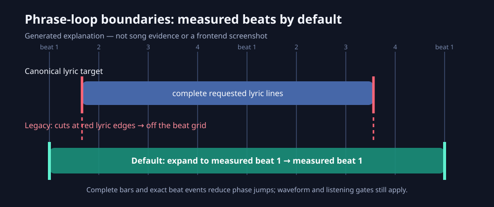

# Phrase loops and musical restarts

`stemlab phrase-loops RESULTS` proposes **line-complete audition candidates**
from explicit `canonical.json` lyric timing. It answers a different question
from conservative `stemlab loops`: which complete lyric passages are worth
trying when the return to the beginning matters? It never upgrades an unresolved
strict loop. Detected-beat boundaries at the same measured bar phase are the
default; line timestamps define what must be included, not the delivered cuts.

```sh
stemlab phrase-loops analysis --min-seconds 5 --max-seconds 30 --top 6 --export-audio
stemlab phrase-loops analysis --feedback artist-ratings.json --export-audio
python scripts/phrase_loop_demo.py --output phrase-demo
# Reproduce legacy line-edge cuts only for comparison or migration review:
stemlab phrase-loops analysis --line-boundaries --max-bar-phase-error 0.125
# Reproduce half-bar exclusions without private song material:
python scripts/phrase_loop_demo.py --output bar-demo --half-bar-endings --max-bar-phase-error 0.125
```



*Generated explanatory diagram, not measured song evidence. A video is omitted
because the relevant dynamic evidence is the exact WAV and its three-repeat seam
audition; moving graphics cannot establish audio continuity.*

Saved beat/section/vocal evidence is reused; no model reruns, native
DanceRudiments runtime or new network dependency are required. The attack
descriptor reuses StemLab's existing RMS-rise event extractor from its
DanceRudiments-matching analysis. DanceRudiments motion patterns are not
reimplemented or used as a substitute for musical listening.

## What changes the ranking

- Candidate targets come from ordered canonical line starts and explicit line
  ends, preserving repeated occurrences and any interior zero-length caption.
  By default the start moves backward to the preceding detected beat and the end
  moves forward to the first detected beat at the same measured bar position.
  If either new boundary touches another timed lyric, that complete line is
  included and the beat alignment repeats until no overlapping lyric is cut.
  Every traversed measured bar must retain the same detected beat count. No
  constant grid, 4/4 meter or missing event is invented. At least four requested
  lines and 5–30 aligned seconds are the defaults.
- The report distinguishes `requested_canonical_line_indices` from
  `canonical_line_indices`/`included_lyrics`, which cover every timed line that
  actually overlaps the expanded audio. Exact duplicate aligned spans are
  suppressed without hiding extra audible lyrics.
- Compare **before with before and after with after** at the two cuts. Chroma
  and log-band context are measured over 350 ms on either side. A last-note
  tail versus first-note attack comparison alone can favour a poor restart.
- Compare RMS-rise attack salience around both cuts over four local measured
  beats (two before and two after), retaining rhythmic accent placement.
- Musical context contributes .75 of cost, local measured beat phase .10,
  similarity to explicitly good/okay durations .10, and raw sample seam .05.
  Within musical context, attacks have .40 weight, chroma .30, spectral bands
  .20 and level mismatch .10. Missing attacks stay null; available weights are
  renormalised and reported. These are fixed descriptive weights, not a
  trained model, calibrated confidence or an automatic modification of the
  existing strict/spectral-context algorithms.
- Greedy selection suppresses alternatives sharing more than 60% of the
  shorter interval. This prevents a list of nested cuts from one passage.
- Default beat alignment requires exact detected beat events and the same detected
  beat ordinal within a consistently measured bar. The separately reported
  time-interpolated bar coordinate may retain a small residual under measured
  tempo drift even when the beat-event span is an exact whole number of bars.
  Optional `--max-bar-phase-error` (0–0.5) remains available for the explicit
  legacy `--line-boundaries` comparison. `0.125` allows at most an eighth of a
  measured bar; it is not a universal listening threshold. Enclosing downbeats
  and consistent detected beats per bar are required. Unknown coverage or
  changing meter is held rather than extrapolated. No artist-confirmed meter,
  phrase cadence or strict seamless-loop approval is inferred.

## Explicit artist feedback

The optional JSON must identify the **exact master hash and native frame
bounds**. Wrong hashes, malformed bounds and unsupported ratings are rejected.
Use the sample numbers in the audition report, never resampled browser frames.

```json
{
  "schema": "stemlab.loop_feedback.v1",
  "source_sha256": "REPLACE_WITH_EXACT_MASTER_SHA256",
  "ratings": [
    {"start_sample": 64000, "end_sample": 128000,
     "rating": "good", "reason": "unknown"},
    {"start_sample": 160000, "end_sample": 192000,
     "rating": "bad", "reason": "musical_restart"}
  ]
}
```

Ratings are `good`, `okay` or `bad`; reasons are `unknown`, `musical_restart` or
`section_unsuitable`. Previously rated near-duplicates (intersection over union
at least .90) are not suggested again, regardless of rating. Good/okay durations
are soft references; a rating does not approve later changed cuts.
`bad` + `section_unsuitable` excludes overlapping cuts and exact ordered
canonical-word repeats of that passage. This is explicit filtering, not
inferred section classification or a general dislike prediction.

## Evidence and limitations

The separate `deep/phrase_loops/phrase_loops.json` uses
`stemlab.phrase_loops.v1`, is indexed in the existing summary/manifest, and
contains the exact master hash, native bounds, requested and actually audible
lyric occurrences, detected beat indices/padding, restart features, measured beat
phase, detected relative bar phase, waveform join and vocal checks, feedback
summary, scored-pool size and rejected counts. Strict `deep/loops/loops.json`
is preserved. The existing strict-loop timeline does not claim these new
exploratory phrases as accepted regions; use exact exported WAVs to audition.

Exports are opt-in exact float32 decoded master slices, preserving native rate
and channel alignment. The default changes duration only by expanding to the
reported measured beat events; no fade, crossfade, stretch or normalisation is
applied. `--line-boundaries` preserves the earlier line-edge duration for
diagnostic comparison. Phrase suggestions always retain listening holds and
failed vocal/waveform gates where applicable.
Line completeness, same-phase context and high chroma similarity cannot prove
a satisfying musical cadence, clear consonants, correct narrative closure or
listener preference. Edge cuts lacking recorded context are not scored.
One song's ratings do not establish general accuracy; synthetic held-out
contexts test the mechanism and real suggestions still require listening.

```sh
python -m pytest tests/test_phrase_loops.py tests/test_loops.py tests/test_loop_integration.py
python -m pytest tests/test_bar_phase.py
```
