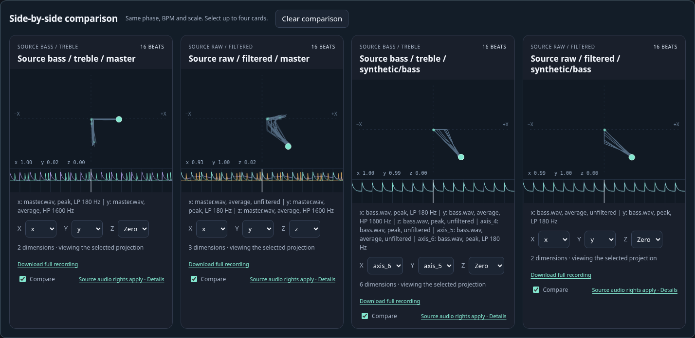

# BPM-synchronised recordings, visualizer and batch generation

`record-rudiment` exports independently routed audio dimensions and an interactive
DanceRudiments comparison harness. `generate-batch` explores a bounded variety of
filtered/unfiltered master/stem combinations. Neither command performs separation,
downloads neural models, copies the movement catalogue or changes source audio.

## Install both companion updates

The format, native sampler and visualizer belong to **DanceRudiments**. StemLab
owns audio extraction and candidate generation, and uses the optional package.
The published `dancerudiments 0.2.4` predates this API; apply/build the companion
DanceRudiments patch first, then the StemLab patch:

```sh
python -m pip install /path/to/updated/DanceRudiments
python -m pip install -e /path/to/updated/stemlab
stemlab record-rudiment --help
stemlab generate-batch --help
```

Building the native extension from source requires a C++17 compiler. The generic
recording WASM accessor is already packaged and verified by checksum: end users
**do not need Emscripten or clang to generate a comparison page**. A source-only
`PYTHONPATH=/path/to/DanceRudiments/python` also enables offline authoring/export;
native Python playback additionally requires the updated compiled extension.
Existing optional `[rudiments]` matching stays unchanged. A missing/old recording
API fails clearly rather than activating a private StemLab fallback.

## BPM and beat phase

Raw audio **requires `--bpm NUMBER`**. It is marked `estimated` unless the caller
also supplies `--bpm-confirmed`. Saved analyses may reuse a successful beat
model's `tempo_bpm`, or derive a median estimate from its timed beats. Automatic
selection prefers consensus, then All-In-One, then the model with most timed
beats. `--beat-model MODEL` selects a particular saved detector. Stale beat JSON
not listed by the current `analysis.json` cannot supply a tempo. Without usable
BPM evidence, the command fails; it never quietly assumes 120 BPM.

`--beat-zero SECONDS` supplies the source time of musical beat zero. Otherwise,
a saved beat sequence can supply an **estimated** phase; origin zero with no
phase evidence remains **unverified**. Confirming BPM does not confirm phase.
Negative initial pip indices retain material before a later first beat.

One beat is a quarter note. Fixed musical resolution is **64 pips per beat**;
the rate in seconds is `64 * BPM / 60` (128 Hz at 120 BPM). Exact rational absolute
sample boundaries prevent accumulated rounded-hop drift. This is a constant-BPM
recording, not a variable-tempo map: changing tempo/phase requires re-export.

## Single recording: bass on X, treble on Y

```sh
stemlab record-rudiment master.wav --bpm 145 \
  --axis x=master --low-pass x=180 \
  --axis y=master --high-pass y=3000 --axis-mode y=average \
  --include-audio --output ./bass-treble
```

Open `bass-treble/index.html`. **Output is a new directory**, not a JSON filename.
It contains the harness, its audit JSON, `report.json`, and
`recordings/audio_recording.json`. Add `--no-harness` for data only. Add `--legacy`
for an additional unchanged XYZ compiled pack (1..3 axes, at most 65,535 pips).
Existing output directories are refused; generation is staged and only published
when successful. Source files and earlier exports are not overwritten.

`--include-audio` explicitly copies the unmodified master into the output directory.
Without it no original audio is copied; select the matching local track in the
harness, or inspect the silent animation. Do not publish copied music unless you
have permission. The HTML itself contains the movement data and all visualizer
assets, requires no CDN and makes no external requests. With copied audio, keep
the entire output directory together.

## Independently route any number of dimensions

```sh
stemlab record-rudiment ./analysis --bpm 145 --bpm-confirmed \
  --axis x=master --low-pass x=180 \
  --axis y=master --high-pass y=3000 \
  --axis z=bs_roformer_sw/drums \
  --axis rotation=bs_roformer_sw/bass --axis-mode rotation=average \
  --axis vocal_energy=bs_roformer_sw/vocals \
  --axis overall=master --axis-mode overall=average \
  --gain rotation=-1 --output ./six-dimensions
```

`--axis NAME=SOURCE` is repeatable and determines dimension order. A source may be
`master`, a unique stem name, `MODEL/STEM`, or an audio file path. Relative paths
are relative to the analysis directory or the input audio's parent. Quote paths
with spaces. Ambiguous stem aliases are errors; the exporter does not silently
choose one separator. Without `--axis`, a file produces a master dimension and
an analysis produces master plus every successful saved model's stems.

There is no XYZ dimension ceiling. The format bounds resource use to 8,388,608
scalar values and 64 MiB per recording JSON. The native N-D recording sampler is
non-looping and supports more than the legacy 65,535-pip loop period. All axes
remain in the data; the visualizer lets you choose which ones to project onto X,
Y and Z. Axis projection does not discard the other dimensions.

Files must already share a time origin. Different native sample rates work
without resampling. Unequal durations fail by default, apart from one-frame
rounding tolerance; explicitly choose `--length-policy pad` or `trim` otherwise.
`--start SECONDS --end SECONDS` restrict the exported excerpt on the original clock.
The command does not infer or repair offsets between independently edited files.

## Window and filter semantics

`--mode peak` takes the **maximum absolute amplitude** across observed samples and
channels within each half-open pip window. `--mode average` takes their **mean
absolute amplitude**. `--axis-mode NAME=peak|average` overrides one axis. These are
amplitude envelopes, not pitch/frequency estimates, signed waveform averaging,
RMS or transient-onset picking. Rectification happens per channel before channel
reduction, so antiphase stereo cannot cancel to silence.

`--low-pass NAME=Hz` and `--high-pass NAME=Hz` act on native-rate audio **before**
rectification/aggregation. Supplying both makes a band-pass, with high-pass cutoff
strictly below low-pass cutoff. Every cutoff must be positive and below that
source's Nyquist frequency. Example bass/treble frequencies are choices, not
universal musical boundaries. `--filter-order` is 1..12, default 4.

Default `--filter-phase zero` is forward/backward Butterworth SOS filtering.
Odd padding/initial states match SciPy `sosfiltfilt`; the magnitude response is
squared by the forward/backward pass. This avoids causal phase delay but does
not eliminate filter ringing or edge effects. Very short inputs use the largest
valid padding. `--filter-phase causal` deliberately permits causal phase delay.

Zero-phase processing uses a temporary disk-backed float64 spool, approximately
`frames * channels * 8` bytes for the active filtered source, then deletes it.
Unfiltered/causal audio streams without that spool. Filter state never resets
at block/pip boundaries. Partial boundary windows average observed samples only;
wholly missing windows are zero. Coverage counts remain in provenance.

`--normalize none` preserves source-relative levels (single-export default).
`global` applies one maximum across axes; `per-axis` scales each axis independently.
Signed `--gain NAME=NUMBER` is applied afterwards. Clipping to [-1,1] is counted;
silence stays zero. The recording declares float64 and rounds to twelve decimals,
matching native double offsets and the compiled-value convention, **not PCM bit depth**.

## Generate a varied batch and comparison page

```sh
# Master plus every saved stem; no separation rerun.
stemlab generate-batch ./analysis --bpm 145 \
  --dimensions 2 --dimensions 3 --dimensions 6 \
  --max-candidates 96 --seed 17 --include-audio --output ./movement-batch

# A master and separate user-supplied stem files.
stemlab generate-batch master.wav --bpm 145 \
  --source bass=bass.wav --source drums=drums.wav --source vocals=vocals.wav \
  --output ./movement-batch-files
```

Open `movement-batch/index.html`. Default target size is
**`min(1024, max(48, 3 * source_count))`**; default dimension sizes are 2 and 3.
Repeat `--dimensions` for arbitrary sizes of two or more. `--max-candidates` explicitly
bounds a run. It must allow at least **two baseline candidates per source**, or
the command refuses before extraction rather than silently omitting stems.

Default source/filter routes are raw, low-pass 180/350 Hz, high-pass 1600/3000 Hz,
and band-pass 180..3000 Hz, each with **peak and average** windows. Presets that
cannot exist below a particular source's Nyquist limit are skipped and reported;
invalid user cutoff values are errors. Repeat batch `--low-pass HZ` and
`--high-pass HZ` to replace defaults; raw remains included. Note that single
export uses `NAME=Hz`, while batch presets use plain numeric Hz values.

Every source receives bass/treble and raw/filtered baselines, followed by seeded
mixed-source, mixed-filter, mode and orientation variations. The same source/
filter pass yields both peak and mean, and is cached for reuse. Baseline duplicates
or flat data remain explicitly labelled to preserve coverage; additional numerical
duplicates/static candidates are skipped. This is a bounded exploration, **not an
exhaustive Cartesian product** or a ranking that claims aesthetic quality.

Batch normalisation defaults to **per-axis**, useful for seeing quieter routes.
It can also amplify tiny out-of-band residuals/background noise. Inspect the
recorded unscaled peaks, or select `--normalize none` / `global` to preserve level
relationships. Filter settings, source identities/rates/hashes, gains, window
modes, baseline status and normalisation remain inspectable in each JSON/report.

The batch budget is 32 million scalar values, with at most 1024 candidates and a
bounded attempt count. The harness deduplicates identical float64 columns and
caps unique binary data at 128 MiB. `report.json` records actual candidate count,
coverage, extraction passes, skipped filters and the limiting reason. Use a
shorter excerpt or a smaller batch for a large 53-stem/long-song job.

## The existing DanceRudiments visualizer, not a lookalike

Both the catalogue/release pages and recording pages use the **same packaged
HTML, CSS, beat-player and application assets** in DanceRudiments. StemLab calls
`dancerudiments_authoring.harness.build_recording_harness`; it does not embed a
second renderer or a movement implementation.

Recording mode retains the existing searchable cards, four-card comparison,
Keep/Maybe/Skip review controls, notes and review JSON import/download. Its shared
transport supports play/pause, restart, seeking and pip stepping. Nothing autoplays;
hiding the tab pauses playback. With music loaded, motion follows the audio
clock. Export BPM and beat origin are locked to prevent relabelling a different
tempo as the original extraction. Recordings stop at the end instead of wrapping.

The packaged native WASM accessor uses the same C++ `recording_component` as the
native N-D class. JavaScript selects stored column/axis descriptors, not a parallel
movement generator. X/Y/Z selectors expose every dimension; full recordings can
be downloaded independently. Background paths/waves may be display-decimated to
2048 points, but playback/full JSON retain every pip. A non-looping path is not
visually closed across its seam.

Review choices may use browser local storage where available; export review JSON
for a portable record. Browsers may restrict local storage or local-file media:
use an allowed local static server when necessary, without disabling security
policies. Source-file identity checks need Web Crypto support. The sample-data
HTML works offline; actual codec playback remains browser-dependent.

Legacy XYZ catalogue/bindings are unchanged. The new arbitrary-dimensional API
is available in native C++/Python and this recording harness; this change does not
claim new general-purpose N-D C# or TypeScript wrappers.

## Reproducible demo and validation

```sh
python examples/recordings/generate_demo.py --output ./recording-demo
python -m pytest tests/test_rudiment_recordings.py tests/test_rudiment_matches.py
```

The demo creates explicitly **synthetic** bass/treble/drum/lead audio and produces
an exact 2-D bass/treble page, a 6-D page, and 48 2/3/6-D batch candidates. It does
not infer stems or BPM from Arcadians. The supplied screenshot is a real Chromium
capture of those generated candidates, using the actual native/WASM visualizer.



Local browser QA used the project's explicit in-memory mode because local-file
navigation was blocked. It verified native samples, audio decoding/clock,
playback, seeking, projection, review download/import and non-looping completion;
it did not establish audible listening quality or local-file loading. Normal CI
uses the actual output files and does not opt into that fallback.

The recording CI workflow builds the separate companion first. Merge that patch
before the StemLab patch, or set repository variable `DANCERUDIMENTS_RECORDING_REF`
to its commit SHA (also available as a workflow-dispatch input). Default is
DanceRudiments `main`; missing APIs fail the job, never a green skip. Each run logs
the exact resolved companion revision. Versions/releases are not changed by these
patches; publish a fresh version only after review and CI.

## Arcadians release publication

StemLab's release process now generates a full-song, 48-candidate master-only
Arcadians batch at 145 BPM, copies the original MP3 unchanged, tests audio-driven
playback, and attaches the complete site to the release. GitHub Pages deployment
is opt-in after successful tagged releases. See [Arcadians release demo and Pages
setup](arcadians-release-demo.md). Public playback needs no user-supplied file.
