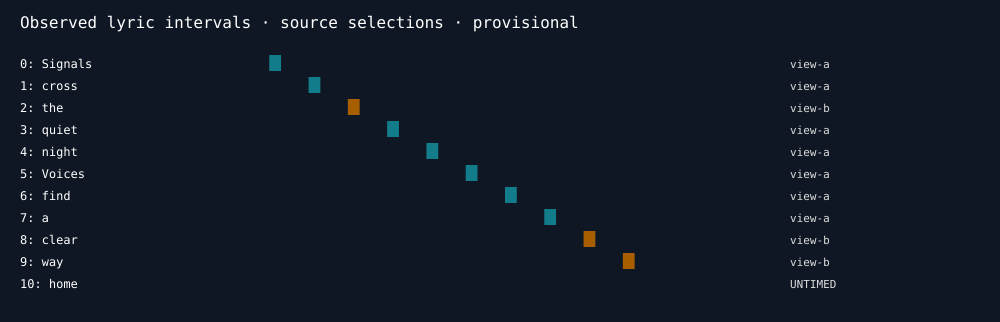

# Synthetic lyric fusion example

This model-free example generates a silent 14-second WAV and two different
canonical-word observation sets. It is original synthetic test material released
under the repository's MIT licence. No real song, lyrics or model weights are
included. The timestamps demonstrate provenance selection; they make no claim
about vocal recognition or singing accuracy.

Run the commands in [the fusion guide](../../docs/lyric-fusion.md#reproduce-without-private-music).
The combined result retains 10 of 11 canonical tokens, fills two baseline gaps
from the second view and leaves the last word untimed.

The actual command-generated selection diagram is the relevant visual. A video
of silent synthetic audio and an unrelated generated illustration add no useful
evidence and are omitted.
